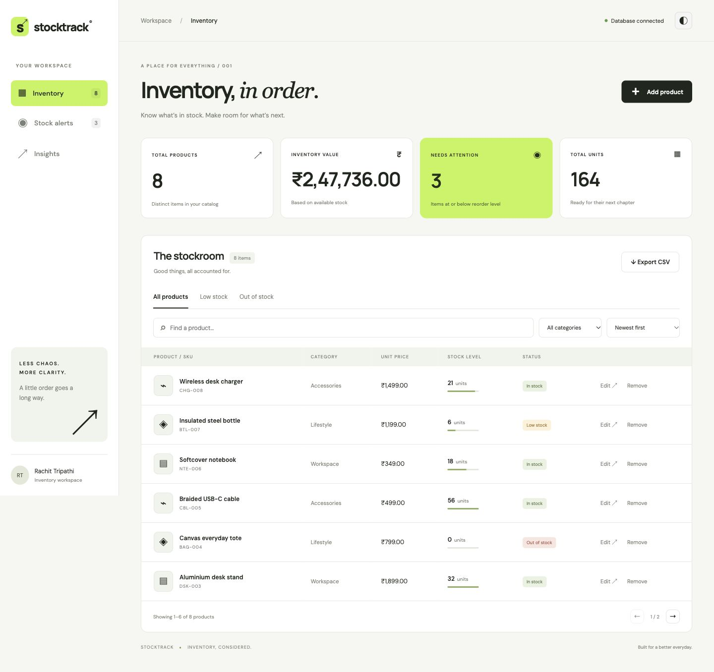
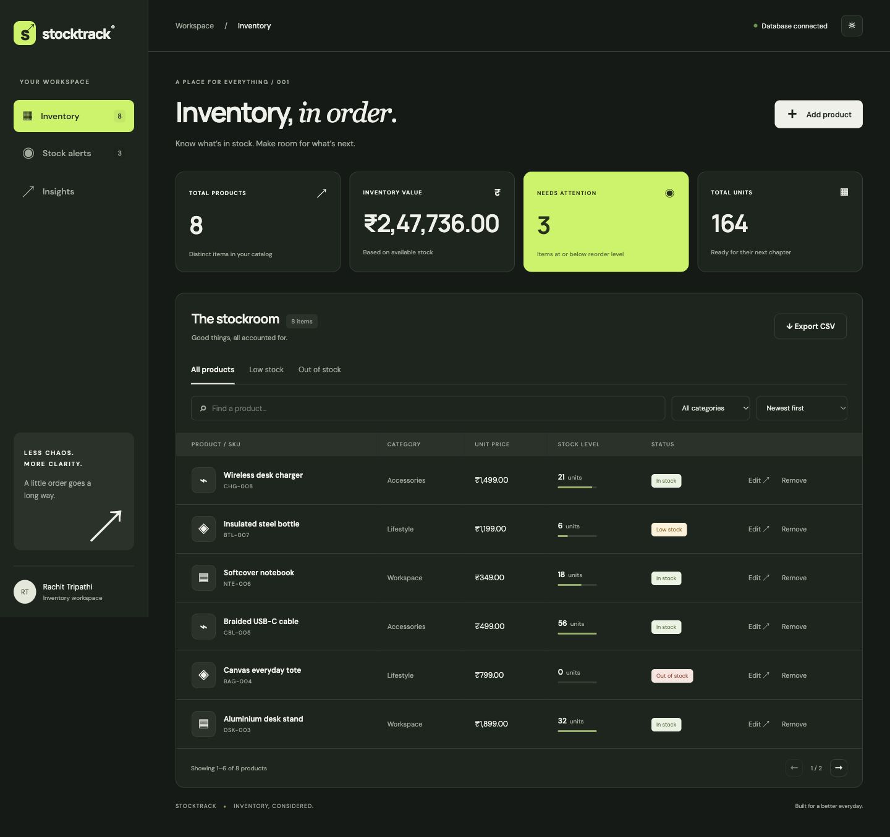
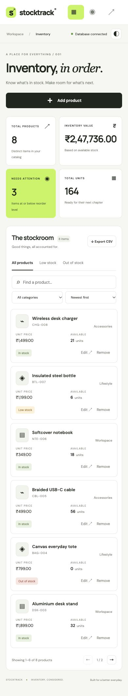

<div align="center">


# StockTrack API

### Inventory, in order.

A considered inventory workspace for managing products, tracking stock levels, and keeping the everyday under control.


**MongoDB + Mongoose · Responsive interface · Light / dark themes**

[Live demo](https://stocktrack-api-rachit.onrender.com) · [Getting started](#getting-started) · [API reference](#api-reference) · [Data model](#data-model) · [Testing](#testing)

</div>

---

## The project

StockTrack connects an Express API to MongoDB through Mongoose and provides an interface for managing a small product inventory. Built for **Code More — Week 5, Task 2: Database Integration with Mongoose**.

The interface pairs a quiet off-white workspace with lime accents, Manrope headings, a serif headline accent, and a persistent navigation rail. On smaller screens, products become compact cards and the navigation moves to the top.

## Preview

**Desktop · light theme**



<details>
<summary>Dark theme and mobile view</summary>





</details>

## Features

- Create, view, edit, and delete products with confirmation before removal.
- Required fields, unique SKUs, category constraints, numeric limits, and whole-number stock validation.
- Search by product name, SKU, or supplier; filter by category and stock status.
- Sort by date, name, quantity, or price, with six products per page.
- See product count, inventory value, units on hand, and reorder alerts.
- Explore category totals in the Insights view.
- Export the complete filtered result set as CSV, including spreadsheet-formula escaping.
- Switch between light and dark themes; remember your preference locally.
- Keyboard-accessible controls, native modal dialogs, reduced-motion support, and loading, empty, and error states.
- Centralized error handling, health checks, connection logging, and graceful shutdown.
- Non-destructive seed utility and an importable Postman collection.

## Technology

| Layer             | Technology                  | Purpose                                             |
| ----------------- | --------------------------- | --------------------------------------------------- |
| Interface         | HTML, CSS, JavaScript       | Responsive views and browser interactions           |
| Server            | Node.js, Express 5          | HTTP routes and static frontend hosting             |
| Database          | MongoDB                     | Persistent product documents                        |
| Modeling          | Mongoose                    | Schema validation, indexes, timestamps, and queries |
| HTTP protection   | Helmet, express-rate-limit  | Security headers and request limits                 |
| Verification      | Node test runner, Supertest | API integration tests                               |
| Local development | mongodb-memory-server       | Isolated temporary MongoDB for demo and tests       |

## Getting started

### Requirements

- Node.js **22 or later** and npm.
- MongoDB Atlas or a local MongoDB instance for persistent storage.
- VS Code is recommended; launch configurations are included.

### Option A: immediate local demo

```bash
npm ci
npm run dev
```

Open **http://localhost:3000**. This starts a real, temporary MongoDB instance and inserts eight sample products. The first run downloads a MongoDB binary. **Demo data resets when the server stops.** This mode does not use your Atlas database.

### Option B: persistent MongoDB / Atlas

```bash
npm ci
cp .env.example .env
```

Edit `.env` locally:

```dotenv
PORT=3000
MONGODB_URI=mongodb+srv://<database-user>:<url-encoded-password>@<cluster>/stocktrack?retryWrites=true&w=majority
NODE_ENV=development
```

Use the Atlas connection string for your own cluster. URL-encode special characters in the password. Create a database user scoped to the `stocktrack` database, and configure network access for the machine or hosting service that runs the API.

```bash
npm run seed
npm start
```

The seed utility inserts sample SKUs only when they do not already exist. It never clears the collection or overwrites existing products.

**Secrets:** `.env` is ignored by Git. Never put real credentials in the README, screenshots, Postman collection, or commits. On Render, use the service’s environment settings for `MONGODB_URI`.

### VS Code

Open this project folder, then use **Run and Debug**:

- **StockTrack: local demo** starts the temporary seeded workspace.
- **StockTrack: Atlas** starts the server using your local `.env`.

### Available commands

| Command        | Behavior                                                    |
| -------------- | ----------------------------------------------------------- |
| `npm run dev`  | Start isolated, seeded local demo                           |
| `npm start`    | Start persistent MongoDB-backed server                      |
| `npm run seed` | Insert missing sample products into the configured database |
| `npm test`     | Run integration tests against isolated MongoDB              |

## Architecture

```text
Browser → Express routes → Product controllers → Mongoose Product → MongoDB
                               ↓
                     Centralized error middleware
```

The Express server hosts the frontend and API together, so deployment needs one web service and no separate frontend API URL. The server waits for its database connection before accepting requests. `SIGINT` and `SIGTERM` close HTTP connections and disconnect MongoDB.

```text
stocktrack-api/
├── public/
│   ├── index.html                 # Inventory workspace and dialogs
│   ├── style.css                  # Themes and responsive layouts
│   ├── app.js                     # Filters, forms, API calls, export
│   └── favicon.svg
├── src/
│   ├── app.js                     # Express setup and routes
│   ├── server.js                  # Startup and shutdown
│   ├── config/db.js               # Database connection and logging
│   ├── models/Product.js          # Schema and validation
│   ├── controllers/productController.js
│   ├── middleware/errorHandler.js
│   └── utils/
│       ├── sampleData.js
│       └── seedDatabase.js
├── tests/products.test.js
├── docs/StockTrack.postman_collection.json
├── .vscode/launch.json
├── .env.example
└── package.json
```

## Data model

MongoDB stores products in the `products` collection. Mongoose adds `_id`, `createdAt`, and `updatedAt`.

| Field                     | Type    | Rules / default                                                      |
| ------------------------- | ------- | -------------------------------------------------------------------- |
| `name`                    | String  | Required; trimmed; 2–100 characters                                  |
| `sku`                     | String  | Required; uppercase; unique index; 3–24 letters, numbers, or hyphens |
| `category`                | String  | Required; Electronics, Workspace, Accessories, or Lifestyle          |
| `price`                   | Number  | Required; 0–10,000,000; currency shown in INR                        |
| `quantity`                | Integer | Required; 0–1,000,000                                                |
| `reorderLevel`            | Integer | 0–1,000,000; defaults to 10                                          |
| `supplier`                | String  | Trimmed; up to 100 characters; defaults to empty                     |
| `notes`                   | String  | Trimmed; up to 500 characters; defaults to empty                     |
| `createdAt` / `updatedAt` | Date    | Automatically managed timestamps                                     |

Unknown fields and MongoDB update operators in client input are rejected. Updates run schema validators. The unique SKU index is enforced by MongoDB; duplicates return `409`.

Stock status is derived: zero quantity is **Out of stock**; quantity at or below the reorder level is **Low stock**; everything else is **In stock**. The attention total includes both low and out-of-stock products. Inventory value is the sum of `price × quantity`.

## API reference

Base path: `/api`. Requests and responses use JSON, except successful deletion (`204`).

| Method | Endpoint        | Success | Purpose                                        |
| ------ | --------------- | ------- | ---------------------------------------------- |
| GET    | `/health`       | 200     | Database connection health; 503 if unavailable |
| GET    | `/products`     | 200     | List products, newest first                    |
| POST   | `/products`     | 201     | Create a product                               |
| GET    | `/products/:id` | 200     | Read one product                               |
| PATCH  | `/products/:id` | 200     | Update supplied fields                         |
| DELETE | `/products/:id` | 204     | Permanently delete one product                 |

### Create a product

```bash
curl -X POST http://localhost:3000/api/products \
  -H 'Content-Type: application/json' \
  -d '{"name":"Desk lamp","sku":"LMP-001","category":"Workspace","price":1299,"quantity":12,"reorderLevel":5}'
```

Successful create/read/update responses use `{ "data": { ...product } }`; lists use `{ "data": [...] }`.

### Errors

| Status | Meaning                                                     |
| ------ | ----------------------------------------------------------- |
| 400    | Invalid fields, malformed ID, invalid JSON, or empty update |
| 404    | Product or endpoint not found                               |
| 409    | Duplicate SKU                                               |
| 413    | Request body exceeds 20 KB                                  |
| 429    | API rate limit exceeded                                     |
| 500    | Unexpected server error; internal details are not exposed   |

Validation errors include field messages:

```json
{
  "message": "Please check your product details",
  "errors": { "quantity": "Quantity must be a whole number" }
}
```

The frontend performs filtering, sorting, and pagination on the product list. This is designed for a small demonstration catalog; large catalogs should add server-side query pagination and indexes appropriate to their usage.

## Testing

```bash
npm test
```

Tests use an isolated MongoDB instance, never your Atlas data. They cover the complete CRUD lifecycle and persistence, default values and timestamps, invalid categories and quantities, duplicate SKUs, rejected update operators, missing records, invalid IDs, frontend delivery, and health checks.

Import `docs/StockTrack.postman_collection.json` into Postman. Set `baseUrl` to the local or deployed origin. Run **Create product** before read/update/delete: its test script saves `productId` automatically. The collection includes expected validation and missing-document cases.

## Deployment on Render

**Live app:** https://stocktrack-api-rachit.onrender.com

Hosted as one Node.js web service in Singapore, connected to MongoDB Atlas. The free hosting plan can take a little time to wake after inactivity.

1. Push this repository to GitHub.
2. Create a Node web service connected to the repository.
3. Build command: `npm ci --omit=dev`.
4. Start command: `npm start`.
5. Set `NODE_ENV=production` and add `MONGODB_URI` as a secret environment variable.
6. Set the health check path to `/api/health`.
7. Configure Atlas network access for the hosting service and deploy.
8. Check the health endpoint, then create, edit, and remove a sample product.

The server binds to `0.0.0.0` and the platform-provided `PORT`. Production requires a persistent MongoDB connection; it never silently falls back to temporary storage. To populate production samples, run the seed command from a trusted environment configured for the same database.

## Scope

This is a public educational inventory demo. It has no authentication or user-specific inventory: anyone with access can edit the shared catalog. Use sample products only. Authentication, authorization, audit logs, and backups are needed before using it for a private business inventory. Quantities are updated directly; this is not a transactional warehouse or accounting system.

## Author

**Rachit Tripathi** · [GitHub](https://github.com/rachit1807)
